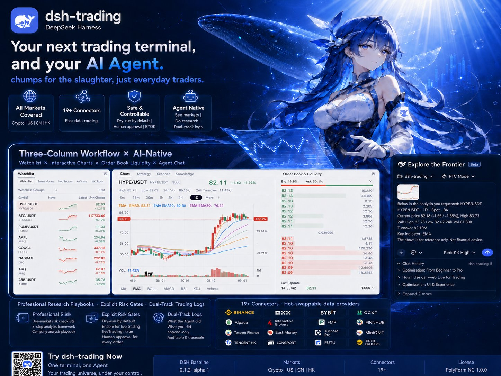
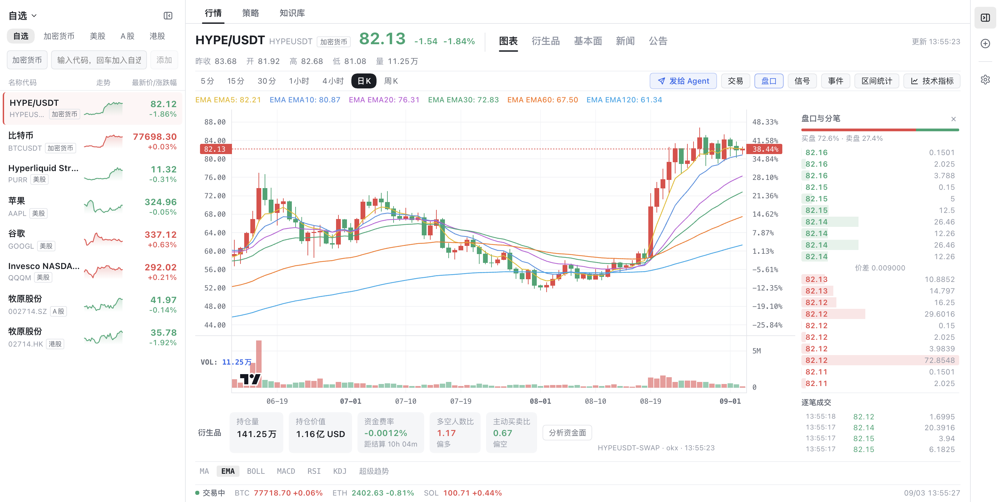
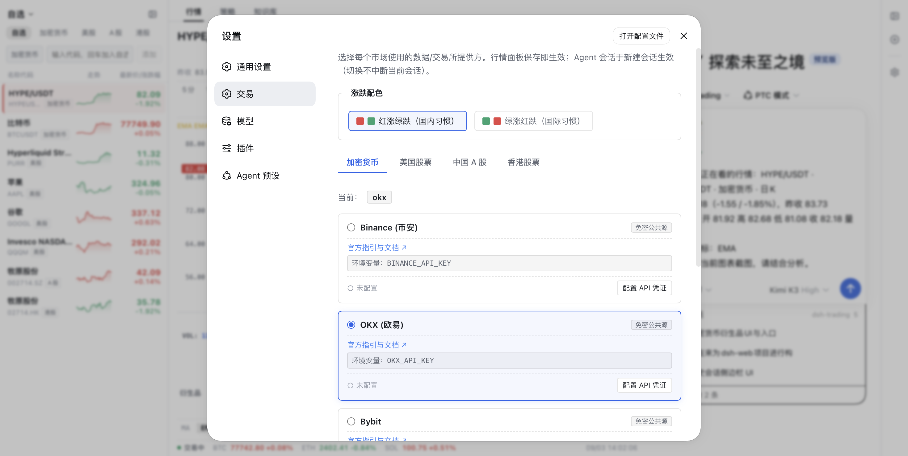
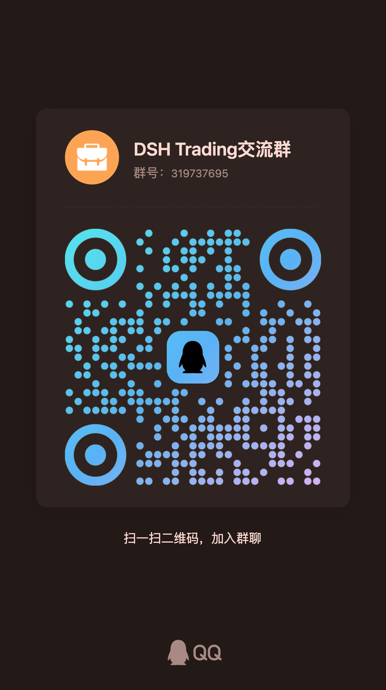

# dsh-trading — Open-Source AI Trading Terminal & Multi-Agent Quantitative Platform

> **Current Status & Handoff** / **当前状态与交接**：See [docs/current-state.md](docs/current-state.md) (accepted milestones, fail-closed invariants, documentation map).

**English** | [简体中文](README_zh.md) | [Русский](README_ru.md)

**dsh-trading** is an open-source, agent-native AI trading terminal, cross-platform desktop application (macOS / Windows), and multi-agent quantitative investment research platform built on [DeepSeek Harness (DSH)](https://github.com/deepseek-ai) and the [Cordis](https://github.com/cordisjs) microkernel. It unifies **Cryptocurrency** (Binance, OKX with perpetual swap trading, Bybit, CCXT across 9 direct spot venues), **US Equities** (Alpaca, Interactive Brokers, Yahoo Finance, FMP, Finnhub, Polygon.io, Stooq), **China A-Shares** (MiniQMT, China Galaxy XYSZ, Eastmoney, Tencent Finance, HiThink, Tushare Pro, AkShare), **Hong Kong Stocks** (Longbridge, Futu, Tiger, Tencent HK), **Chinese Commodity & Index Futures** (HiThink), and **Global Commodities, FX & Prediction Markets** (Jin10 MCP 97 instruments + read-only Polymarket FOMC probabilities) inside a single modular workspace.

Combining TradingView Lightweight Charts v5 (with right-click **KDAS key-day anchored lines** and cross-source 5-day intraday routing), a three-view center stage (**Quotes / Strategy Backtester & Screeners / Force-Directed Knowledge Graph**), a six-panel right-rail cockpit (Scheduled Tasks, Unified Holdings Ledger, Jin10 Flash News, Macro Calendar & Central Bank Rates, Workspace Files, Polymarket FOMC Odds), role-based multi-agent teams (`master` lead, `instrument-researcher`, `trader`, `risk-reviewer`, and three delegate presets), and a zero-trust dual-track human approval gate, dsh-trading bridges deep AI reasoning and disciplined execution via both CLI Web mode and a ready-to-run desktop client.

[Quick start](#quick-start) · [Key features](#key-features) · [Why dsh-trading](#why-dsh-trading-vs-alternatives) · [Supported markets](#supported-markets--broker-connectors) · [Agent architecture](#what-does-agent-native-mean) · [FAQ](#frequently-asked-questions-faq) · [Documentation](#documentation)



> **Your next trading terminal can also be your AI agent.**
> *No chumps for the slaughter, just everyday traders.*

<div align="center">

[](https://github.com/deepseek-ai)
[](https://github.com/zhu1090093659/dsh-trading/releases)
[](#supported-markets--broker-connectors)
[](docs/guides/connectors-guide.md)
[](https://github.com/cordisjs)
[](https://tradingview.github.io/lightweight-charts/)
[](#zero-trust-safety--execution-discipline)
[](LICENSE)

</div>

---

## Key Features

- **Six-Market Coverage & Host Watchlist Ledger:** Track Crypto spot and perpetual swaps (`-SWAP`, OKX `ctVal` contract conversion & `crypto_set_leverage`), US stocks, China A-shares, Hong Kong stocks, domestic futures, and 97 global FX/commodity/index symbols in one workspace backed by host-persisted `@dshtrading/watchlist` groups.
- **Three-View Center Stage & Six-Panel Right Cockpit:** Center `MiddleStage` integrates **Quotes** (Lightweight Charts v5, cross-source 5-day intraday routing for CN/HK, right-click **KDAS key-day anchors**, OKX-style inline indicator editing, and crypto derivatives telemetry), **Strategies** (`strategy_backtest` / `strategy_author` across 6 paradigms and 5 market screeners), and **Knowledge Base** (Obsidian-style force-directed graph and structured research cards); the right-rail hosts **Scheduled Tasks, Unified Holdings Ledger (`@dshtrading/holdings`), Jin10 Flash News, Macro Calendar & ~30 Central Bank Rates, Workspace Files, and Polymarket FOMC Odds**.
- **Zero-Setup Cross-Platform Desktop Client:** Dual-track `desktop/` builds package both Electron (macOS arm64/x64 & Windows x64 NSIS) and a native Go/WebView `mygo` shell with bundled Node/pnpm, DSH host, isolated `~/.dsh-trading` home seeding, and an in-app updater (`@dshtrading/client-ui-updater`).
- **Agent-Native Multi-Agent Orchestration & Tool Batching:** `master` coordinates three delegate presets (`researcher_subagent`, `trader_subagent`, `risk_reviewer_subagent`), two-stage tool loading on `instrument-researcher`, parallel read-only exploration via `trading_batch`, and dynamic tool discovery via `trading_tools_index` alongside the bundled "Chinese Master Quotes" pack (`@dshtrading/client-ui-masters-quotes`).
- **Institutional Research Playbooks & Six-Market Checklists:** Bundled pre-trade risk checklists across all six markets (Crypto, US, CN, HK, Futures, Global), 5-step crypto analysis framework, company valuation playbook, `content-insight` media distillation, weekly trading plan synthesis, and append-only dual-track trading journals.
- **Quantitative Strategy Backtesting, Screeners & Indicator Authoring:** Native `strategy_backtest` engine (Donchian breakout, RSI mean-reversion, EMA crossover, Bollinger Bands reversion, 200-day moving average, and 12-month momentum), `screener_run`/`screener_author` scanners, and `indicator_author` + `indicator_get_values`.
- **Zero-Trust Dual-Track Gate & BYOK Privacy:** Order routing defaults to dry-run simulation; live orders require explicit `liveTrading: true`, interactive human approval, and an Ed25519 authority grant (fail-closed when headless). All API keys, broker credentials, holdings ledgers, and knowledge graphs stay strictly local under `~/.dsh-trading`.

---

First, a question for you:

Of the money you've lost trading, how much of it was lost before you had truly thought it through?

You chase a rally and become the exit liquidity. You buy the dip, and it keeps dipping. You cut the loss, and it bounces the moment you're out; you hold, and it grinds you into the deep red. (Veterans don't always dodge these either.)

Where does the problem lie? Not in luck. In discipline.

The market opens every day, and bulls and bears fight it out every day. The most dependable weapon a retail trader holds was never better information — it's discipline. A seasoned hunter waits nine-tenths of the time and strikes in the remaining tenth; most traders do the exact opposite — nine-tenths acting, one-tenth regretting.

That is why dsh-trading exists: an **agent-native trading terminal** built on [DeepSeek Harness (DSH)](https://github.com/deepseek-ai). A professional trading workflow, paired with an AI agent in sync with the market: quotes, news, and capital flow are all in its view; research follows institutional-grade playbooks; and before a real order goes out, every single one passes an approval gate that only your hand can click.

Crypto, US equities, China A-shares, Hong Kong stocks, domestic futures, global commodities/FX, and prediction markets. One terminal. One agent team. Twenty-three connectors. Ready-to-run Desktop App. Zero vendor lock-in — every key, position ledger, and knowledge graph stays on your machine.



---

## Why dsh-trading vs. Alternatives?

| Dimension | Traditional Trading Terminals (TradingView / Broker Apps) | Generic AI Chatbots (ChatGPT / Copilot sidebars) | **dsh-trading (Agent-Native Terminal)** |
|---|---|---|---|
| **Multi-Market Scope** | Fragmented accounts across different apps | Text-only dialogue; no live market feeds | **Host watchlist & dock unifying Crypto, US, CN, HK, Futures, 97 Global symbols + Macro/FOMC** |
| **Real-Time Market Depth** | Expensive subscriptions; walled gardens | Hallucinations; zero tick data or order books | **Live L2 order book, tick trades, crypto perps (`-SWAP` / `ctVal`), OI/funding & KDAS anchors** |
| **Terminal Integration** | None or simple external alerts | Chatbox glued next to chart; manual copy-paste | **First-class citizen: `trading_batch` calls, native quotes, backtesting & knowledge graph** |
| **Multi-Agent Architecture** | None | Single prompt / single model | **`master` lead + 3 delegate presets + 2-stage `instrument-researcher` + `trader` + `risk-reviewer`** |
| **Investment Research** | Manual reading across disparate websites | Generic web-search summaries | **6 market risk checklists, `content-insight` distillation, Obsidian-style graph & weekly plan** |
| **Strategy & Backtesting** | Proprietary scripting (Pine Script) in silos | Cannot run code on real market feeds | **6 backtest paradigms + 5 screeners (`strategy_backtest` / `screener_run`) + custom indicators** |
| **Execution Safety** | Manual clicks or opaque black-box algos | Dangerous unmonitored execution or none | **Dual-track gate: Dry-run by default, human approval for live orders, Ed25519 authority** |
| **Privacy & Credentials** | Keys stored on third-party cloud servers | Prompts & data sent to external cloud AI | **100% BYOK stored locally on your machine, zero data redistribution** |

---

## What does agent-native mean?

What do most "AI trading tools" look like? A chat box glued to the side of the chart.

Glued on, not grown in.

dsh-trading turns that relationship upside down: **the agent is a first-class citizen of the terminal, and the terminal is the agent's body.** Four things separate it from every chatbot you've used:

1. **Quotes, news, capital flow — the agent has it all.** Live quotes, the current candle, the chart series' time range with a fetch locator (so the agent pulls the same routed data itself and analyzes it in code), the computed readings of your active indicators, derivatives snapshots, plus announcements, news and a bounded fundamentals summary — all native tools the agent drives for the symbol you're watching. Missing sources are explicit; the agent is guided to verify original disclosures and fill gaps with native research tools. No more screenshot-copy-paste ritual.

2. **The agent can trade, but the gate is in your hands.** Market data, order books, derivatives positioning, news, and order placement are all native tools. Yet every order defaults to **dry-run simulation**; live routing requires an explicit `liveTrading: true` opt-in, and then each order still passes through interactive human approval. In headless environments it fails closed. One rule: no move without the gate. Nothing executes behind your back.

3. **The agent trained for this.** Domain knowledge ships as bundled skills, not model improvisation: pre-trade risk checklists for all six markets ([crypto](.agents/skills/crypto-risk-checklist/SKILL.md) · [US](.agents/skills/us-risk-checklist/SKILL.md) · [CN](.agents/skills/cn-risk-checklist/SKILL.md) · [HK](.agents/skills/hk-risk-checklist/SKILL.md) · [Futures](.agents/skills/futures-risk-checklist/SKILL.md) · [Global](.agents/skills/global-risk-checklist/SKILL.md)), a five-step [crypto instrument analysis framework](.agents/skills/crypto-instrument-analysis/SKILL.md), a full [company analysis playbook](.agents/skills/company-analysis/SKILL.md), [strategy paradigms](.agents/skills/trading-strategy-paradigms/SKILL.md), [knowledge curation](.agents/skills/knowledge-curation/SKILL.md), and a [trading journal discipline](.agents/skills/trading-notes-setup/SKILL.md) that dual-tracks "what the agent did" versus "what you did" — append-only and auditable.

The risk checklist runs before every entry — a discipline most veterans never sustain in ten years (usually undone by "just this once").

4. **One master leading a role-based team.** `master` (大师) is the all-capable multi-agent team lead: it grounds every trade question in the unified holdings ledger (`holdings_list` / `holdings_stage`) and per-market balance tools, pulls the user knowledge base first (`knowledge_search` / `knowledge_graph`), uses `trading_batch` and `trading_tools_index` for parallel exploration and dynamic tool discovery, and delegates specialist work to three dedicated delegate presets — instrument analysis to the researcher (`researcher_subagent`), trading-plan drafting to the trader (`trader_subagent`), and plan review to the risk reviewer (`risk_reviewer_subagent`) — dispatching project skills by task type (analysis frameworks, market risk checklists, strategy paradigms with `strategy_backtest`, `screener_run` stock/coin scanners) before cross-checking and integrating a single conclusion. Cross-market overviews and order execution it can do itself, still dry-run by default behind the approval gate; delegates deliver analysis text only — execution stays with the master behind the gate. Beneath it: `trader` (交易员) for trading plans and gated execution, `instrument-researcher` (标的分析研究员) with two-stage tool loading (keeping seldom-used schemas paged out until activated) for disclosures, fundamentals and valuation, and `risk-reviewer` (风险审查员) for exposure, stress scenarios and rejection conditions. Every role prioritizes project knowledge, news/announcements and fundamentals tools. Research and risk retain read-only quotes/candles but mount no order/cancel connectors; subagents inherit the session toolset with a persona pinning their duties — shared host tools remain visible, so role scoping is not a separate security sandbox.

The base installer generates these four roles from enabled market bundles, including partial-market installations; the deployment default for new sessions is 大师 (master) — overridable per user in settings. Unmodified managed legacy market presets move to a sibling `.legacy-backup` root; custom, unstamped or extended directories remain untouched. No user preset data is deleted.

---

## The terminal itself must be real software first

A shoddy terminal makes even the smartest agent an armchair general.

- **Three-view center stage (`MiddleStage` — Quotes / Strategies / Knowledge Base):** Features **Quotes** (Lightweight Charts v5 from 5m to weekly plus cross-source 5-day intraday routing for CN/HK equities, editable MA / EMA / BOLL / MACD / RSI / KDJ / SuperTrend with `indicator_get_values`, and **right-click KDAS key-day anchored lines**), **Strategies** (`@dshtrading/client-ui-strategies` powering `strategy_backtest`/`strategy_author` across 6 classical paradigms, equity curves, and 5 market screeners), and **Knowledge Base** (`@dshtrading/client-ui-knowledge` with an Obsidian-style force-directed graph, topic clustering, and Markdown knowledge cards).
- **Six-panel right cockpit (`SessionRail`) & host watchlist ledger:** Right-rail panels unify Scheduled Tasks, Unified Holdings Ledger (`@dshtrading/holdings` two-zone staged/confirmed ledger with FX translation), Jin10 Flash News (with `hot` heat filtering), Macro Calendar & ~30 Central Bank Rates, Workspace Files, and Polymarket FOMC Prediction Markets. Left watchlist persists to `@dshtrading/watchlist` with custom groups, keeping crypto perps beside AAPL, Kweichow Moutai, and Spot Gold.
- **Real market depth & perpetuals cockpit:** Live order book with buy/sell pressure bars, tick-by-tick trades, perpetual swap (`-SWAP`) open interest, funding rates with settlement countdown, long/short ratio, taker flow, OKX `crypto_set_leverage`, and automatic `ctVal` contract-to-coin conversion — all exposed natively to agents.
- **Desktop client & locale packs out of the box:** `desktop/` ships dual-track Electron (macOS arm64/x64 & Windows x64 NSIS) and native Go/WebView `mygo` installers with `@dshtrading/client-ui-updater` and the bundled `@dshtrading/client-ui-masters-quotes` language pack.

### The operations surface is built in

- **Usage statistics:** DSH's built-in *Performance & Usage* settings surface each session's live token stream and spend, resolved host-side so credentials never reach the browser.
- **Plugin manager & desktop updates:** The Plugins section gains a manager tab (install from npm or git, enable/disable switches, verified updates gated on declared minimum DSH versions, rollback, and failure handoff), while desktop builds bundle `@dshtrading/client-ui-updater` for in-app upgrades; writes are loopback-only.
- **Per-model capability declarations:** Every custom `llm-pi-ai` provider card carries a capability area: declare image input and reasoning efforts per model (including the exact wire value each level sends), or archive a provider to take its route down without touching its stored keys.

---

## Supported Markets & Broker Connectors

dsh-trading connects to 23 market data providers, cryptocurrency exchanges, licensed stock brokers, and cross-market intelligence feeds:

| Market | Supported Providers & Broker Connectors | Coverage & Data Plane Capabilities | Execution & Auth Mode |
|---|---|---|---|
| **Cryptocurrency** | **Binance**, **OKX** (Paper/Live), **Bybit**, **CCXT** (spot-only aggregation across nine exchanges) | Binance / OKX / Bybit: spot & perpetual swap (`-SWAP`) quotes, depth, historical candles, open interest, funding rates, long/short ratio. CCXT: spot quotes and candles on nine direct routes (binance, okx, bybit, gateio, kucoin, kraken, coinbase, bitfinex, htx) with per-venue candle interval mapping — perpetual `-SWAP` symbols rejected | REST polling, BYOK API keys; OKX contract trading with `crypto_set_leverage` & auto `ctVal` unit conversion |
| **US Equities** | **Alpaca** (Paper/Live), **Interactive Brokers (IBKR)**, **Yahoo Finance**, **FMP**, **Finnhub**, **Polygon.io**, **Stooq** | Real-time quotes, historical & intraday K-lines, balance sheet & cash flow fundamentals, SEC filings, analyst sentiment (`Stooq` preserved as backup CSV daily source, subject to exit anti-bot checks) | Official Broker REST/WS APIs, BYOK credentials; Yahoo Finance free public endpoints |
| **China A-Shares** | **MiniQMT (QMT / XtQuant)**, **China Galaxy XYSZ (`xysz`)**, **Tencent Finance**, **Eastmoney (东方财富)**, **HiThink (同花顺/富遥)**, **Tushare Pro**, **AkShare** | Real-time L1/L2 quotes, auction prices, daily/minute K-lines (`xysz` serves full 1m–1M history since 2013 and A-share rosters), 5-day cross-source intraday routing, sector capital flow, valuation metrics | Local MiniQMT gateway for live execution; local FastAPI bridge (`xysz-api`); public REST & token authentication |
| **Hong Kong Stocks** | **Longbridge (长桥 OpenAPI)**, **Futu OpenD (富途)**, **Tiger (老虎证券 OpenAPI)**, **Tencent HK** | Real-time quotes, Level 2 market data, 5-day cross-source intraday routing, warrants & CBBCs | Licensed Broker OpenAPI / Gateway execution; Tencent HK public quotes |
| **Commodity & Index Futures** | **HiThink (同花顺/富遥期货)** | Daily K-lines, intraday tick points, dominant contracts across SHFE/DCE/CZCE/CFFEX/GFEX | Institutional REST API (data-plane only) |
| **Global Markets, Macro & Predictions** | **Jin10 MCP (`jin10`)**, **Polymarket (`polymarket`)** | 97 global precious metals, crude oil, copper, FX & index instruments (`1m`–`1h`), real-time flash news with `hot` filter, economic calendar & ~30 central bank policy rates; Polymarket read-only FOMC rate-path implied probabilities | Jin10 Streamable HTTP MCP token (BYOK, public heat feed quota-free); Polymarket public Gamma/CLOB API (zero keys, strictly read-only) |

**Hot-swappable data planes:** Not happy with a data source? Swap it. **Settings → Trading** routes any market to any installed provider: the quote panel re-routes on save, agent sessions pick it up on their next turn — no restarts, no config archaeology.



---

## Zero-Trust Safety & Execution Discipline

The formula of trading has always been: **study + waiting + decisiveness + patience = survival.**

The tool cannot wait for you, and it cannot be patient for you. But it can hold the gate in between:

1. **Dry-run by default:** Every order and cancellation tool executes in simulation mode unless you explicitly flip `liveTrading: true`.
2. **Interactive human approval for live orders:** DSH's approval layer intercepts live routing; headless execution sessions fail closed.
3. **100% BYOK (Bring Your Own Keys):** API keys and broker credentials live in your local environment variables or local configs. Nothing is bundled, relayed, or uploaded to any third-party server.
4. **Zero data re-distribution:** Market data is fetched strictly for your individual usage under each provider's Terms of Service. Nothing is scraped or cached for resale or sharing.

Without your signature, not a single cent moves.

---

## Quick Start

### 1. Desktop App (Recommended, Zero Setup)

Download an installer from [GitHub Releases](https://github.com/zhu1090093659/dsh-trading/releases) (dual-track Electron and native Go/WebView `mygo` builds for macOS Apple Silicon / Intel `.dmg`/`.zip` and Windows x64 NSIS `.exe`). The app bundles Node, pnpm, and the DSH host runtime, automatically seeds an isolated `~/.dsh-trading` home with the `trading-web` profile on first launch without touching `~/.dsh`, and receives updates via the built-in `@dshtrading/client-ui-updater`. See [desktop/README.md](desktop/README.md).

### 2. CLI Installation & Launch

Trading runs in its own dedicated DSH home directory (`~/.dsh-trading`) so it never mixes with your main dsh web home (`~/.dsh`). Every dsh-trading package resolves paths through `$DSH_HOME`.

```sh
# Install into a dedicated DSH profile (pick your markets)
export DSH_HOME=~/.dsh-trading
dsh plugin --profile trading-web add @dshtrading/base @dshtrading/gui @dshtrading/bot-api @dshtrading/crypto @dshtrading/us

# Or install all six markets at once
dsh plugin --profile trading-web add @dshtrading/base @dshtrading/gui @dshtrading/bot-api @dshtrading/crypto @dshtrading/us @dshtrading/cn @dshtrading/hk @dshtrading/futures @dshtrading/global

# Serve the browser UI in this profile (run once): insert the in-box web host layer
node -e "const f=(process.env.DSH_HOME||require('os').homedir()+'/.dsh-trading')+'/profiles/trading-web/package.json',fs=require('fs'),m=JSON.parse(fs.readFileSync(f,'utf8'));m.dsh.profile.bundles.includes('@deepseek-ai/dsh-web-app')||m.dsh.profile.bundles.splice(1,0,'@deepseek-ai/dsh-web-app');fs.writeFileSync(f,JSON.stringify(m,null,2)+'\n')"
```

Launch:

```sh
# From a repository checkout: install the wrapper once, then launch
cp scripts/home/dsh-trading ~/.local/bin/ && chmod +x ~/.local/bin/dsh-trading
dsh-trading --profile trading-web        # serves on port 8888 by default

# Installed from npm only? Set DSH_HOME and port 8888 explicitly:
DSH_HOME=~/.dsh-trading dsh --profile trading-web --port 8888
```

Profiles ship for different operational needs:

| Profile | Interface Surface | Included Bundles |
|---|---|---|
| `trading-web` | Browser GUI (recommended) | dsh-base + dsh-web-app + base + gui + bot-api + crypto + us + cn + hk + futures + global |
| `trading-dev` | Headless, single market | dsh-base + dsh-headless + base + crypto |
| `trading-all` | Headless, all markets | dsh-base + dsh-headless + base + all + cn + crypto + hk + us |
| `trading-bot` | Bot surface: agent host + `/dshtrading/api`, loopback-only | dsh-base + base + bot + bot-api + crypto — source in the private [dsh-trading-bot](https://github.com/zhu1090093659/dsh-trading-bot) repo |

Open the printed URL in your browser: six-market watchlist on the left, Quotes / Strategies / Knowledge Base stage in the center, and your AI trading team and right-rail cockpit on the right. Create a new conversation → choose 大师 (`master`, default) or a market preset → ask the agent: *"What do you see in the market today?"*

### 3. Build From Source

```sh
pnpm install && pnpm build && pnpm test   # Requires Node >= 24.9.0, pnpm 11
./scripts/refresh-profile.sh              # Rebuild profile file: copies (default trading-web)
```

See [docs/ops/running.md](docs/ops/running.md) for the complete running, profile, and refresh contract.

---

## Architecture at a Glance

A modular, layered [Cordis](https://github.com/cordisjs) microkernel architecture where markets compose cleanly without interference:

```
@dshtrading/base          ← Core: account/order/quote contracts, approval gate, presets, trading_batch
├── @dshtrading/gui + bot-api  ← Three-column cockpit UI, /dshtrading/api bridge, Strategies & Knowledge UI
├── @dshtrading/crypto    ← Binance / OKX / Bybit / CCXT + perpetuals + skills
├── @dshtrading/us        ← Yahoo / Alpaca / FMP / Finnhub / Polygon / IBKR / Stooq + skills
├── @dshtrading/cn        ← Tencent / Eastmoney / HiThink / Tushare / AkShare / MiniQMT / XYSZ + skills
├── @dshtrading/hk        ← Tencent HK / Longbridge / Futu / Tiger + skills
├── @dshtrading/futures   ← HiThink Chinese commodity & index futures + skills
└── @dshtrading/global    ← Jin10 MCP 97 global assets + Polymarket FOMC odds + skills
```

Six architectural invariants safeguard the system:
1. Bundle patches are strictly **insert-only**.
2. Domain knowledge lives in **reusable skills**, not hardcoded prompt hacks.
3. Dual-track order gates protect every trade.
4. Shared code must serve **≥2 markets** before entering base.
5. **Zero data re-distribution** under provider Terms of Service.
6. The GUI shell is replaceable; data contracts are immutable.

### Live-Trading Authority Plane (Shipped & Off by Default)

- **Live-trading authority plane:** Live execution toggles do not reside on the agent-writable path. A human-signed cryptographic grant (Ed25519) is the sole mechanism that can unlock live order routing, and the agent side never accesses signing material. This ships in `packages/authority`, alongside the public GUI market-data bridge (`packages/bot-api`).
- **Autonomous bot plane boundary:** The autonomous trading plane (background bot daemon, automated mandate enforcement, web cockpit, native iOS observation client, and systemd units) lives in the private satellite repository [dsh-trading-bot](https://github.com/zhu1090093659/dsh-trading-bot). This public repository retains only the clean seams necessary for independent building.

---

## Data Sources & Terms

| Market | Default Source | Boundary & Compliance |
|---|---|---|
| **US Equities** | Yahoo Finance / Alpaca | Yahoo public endpoints (individual noncommercial use); Alpaca official Paper/Live APIs |
| **China A-Shares** | Tencent Finance / Eastmoney / HiThink (Fuyao) | Public endpoints; HiThink REST API for daily K, fundamentals & auction data; live execution via local MiniQMT broker gateway |
| **Futures (CN)** | HiThink (Fuyao) | HiThink REST API for daily K, intraday points, commodity & index futures; data plane only |
| **Hong Kong** | Tencent HK / Longbridge | Public endpoints; licensed broker OpenAPI/Gateway for execution |
| **Global, Macro & Prediction** | Jin10 MCP / Polymarket | Jin10 Streamable HTTP MCP (1500 calls/day/tool, flash items return titles/timestamps/links only); Polymarket read-only public API |
| **Crypto** | Binance / OKX | Official exchange APIs; OKX paper trading with BYOK credentials |
| **Crypto Fundamentals** | CoinCap | Public REST, individual use only — no redistribution, no bulk scraping |

---

## Frequently Asked Questions (FAQ)

### Is dsh-trading an autonomous trading bot?

It is an **AI-assisted trading terminal**, not an unattended live-trading bot. Order tools default to dry-run simulation. Live execution requires explicit `liveTrading: true` opt-in and interactive human approval; headless sessions fail closed. Dry-run simulation is distinct from exchange or broker paper trading.

### Which exchanges, brokers, and market data APIs can I connect?

dsh-trading ships 23 connectors: **Binance, OKX, Bybit, CCXT (spot quotes and candles on nine direct routes: binance / okx / bybit / gateio / kucoin / kraken / coinbase / bitfinex / htx)** for crypto; **Alpaca, Interactive Brokers (IBKR), Yahoo Finance, FMP, Finnhub, Polygon.io, Stooq** for US stocks; **MiniQMT, China Galaxy XYSZ (`xysz`), Tencent Finance, Eastmoney, HiThink, Tushare Pro, AkShare** for China A-shares; **Longbridge, Futu OpenD, Tiger OpenAPI, Tencent HK** for Hong Kong stocks; **HiThink** for commodity & index futures; and **Jin10 MCP** (97 global FX/commodity/index symbols, economic calendar, central bank rates & flash news) plus **Polymarket** (read-only FOMC probabilities) for cross-market intelligence. See the [connector configuration guide](docs/guides/connectors-guide.md).

### Which AI models can be used with dsh-trading?

dsh-trading runs on DeepSeek Harness (DSH), supporting **DeepSeek (V4.1 / V3 / R1)**, Anthropic Claude, OpenAI GPT series, Google Gemini, Kimi, GLM, and custom OpenAI-compatible endpoints or local models (via Ollama / vLLM). You can configure reasoning effort, image capabilities, and token budgets per model in settings.

### Is there a standalone Desktop App? Will it touch my existing DSH setup?

Yes. [GitHub Releases](https://github.com/zhu1090093659/dsh-trading/releases) ships dual-track Electron and native Go/WebView `mygo` builds for macOS (arm64/x64) and Windows x64. They bundle Node/pnpm and the six-market payload, isolate all configs and sessions under `~/.dsh-trading` separately from `~/.dsh`, and include the built-in `@dshtrading/client-ui-updater`. See [desktop/README.md](desktop/README.md).

### Do I need API keys to use the terminal?

Some public market data sources (such as Tencent Finance, Eastmoney, Yahoo Finance, and read-only Polymarket FOMC feeds) work out of the box without keys. Authenticated services (Jin10 global/calendar MCP, broker gateways, cryptocurrency exchanges) and your selected AI provider require separate credentials (**BYOK**), stored strictly on your local machine under `~/.dsh-trading`.

### Can I backtest trading strategies, screen stocks, and build a knowledge graph?

Yes. The center stage natively runs `strategy_backtest` / `strategy_author` across classical quantitative paradigms (Donchian breakout, RSI mean-reversion, EMA crossover, Bollinger Bands reversion, 200-day moving average, 12-month momentum) and 5 market screeners (`screener_run`), alongside custom indicators (`indicator-authoring`) and right-click **KDAS key-day anchors**. An Obsidian-style Knowledge Graph and `content-insight` workflow organize your research notes locally.

### Is dsh-trading free for commercial use?

No. The [PolyForm Noncommercial 1.0.0 license](LICENSE) permits personal, educational, and research use free of charge. Commercial use requires prior written authorization. The software does not provide investment advice or guarantee trading returns.

---

## Documentation

- [Documentation Index](docs/README.md)
- [Desktop App Guide (macOS & Windows)](desktop/README.md)
- [Running, Profiles & Development](docs/ops/running.md)
- [Connector Onboarding & Configuration (23 Connectors)](docs/guides/connectors-guide.md)
- [New Connector Playbook](docs/guides/connector-playbook.md)
- [Skills Architecture Guide](docs/guides/skills-guide.md)
- [Strategy Tab & Screener Design](docs/design/strategy-tab.md)
- [Trading Knowledge Graph Design](docs/design/knowledge-graph.md)
- [Unified Holdings Ledger Design](docs/design/holdings-ledger.md)
- [Symbol Vocabulary Standard](docs/guides/symbol-vocabulary.md)
- [Exchange Routing & Data Plane](docs/guides/exchange-routing.md)
- [Analysis & Quantitative Roadmap](docs/roadmap/analysis-roadmap.md)
- [Architecture Decision Log (Spikes)](spikes/REVIEW-LOG.md)
- [简体中文说明](README_zh.md)
- [Русский перевод](README_ru.md)

## Friendly Links

- [dsh-web](https://github.com/zhu1090093659/dsh-web)
- [LINUX DO](https://linux.do)

## Community

**QQ Group: DSH Trading 交流群（群号 `319737695`）** — questions, feedback, and everything dsh-trading. Scan with QQ to join:

<div align="center">



</div>

---

## One Last Word

Tools are dead things; discipline is alive. The finest terminal cannot press buy for you, and it should not — but it can make sure that every time your hand does move, the thinking has already happened.

Go experience it. Go make the mistakes. Go review your trades. The road is long — onwards, together.

**This project is software, not investment advice. Markets carry risk — trade with care.**

## License

[PolyForm Noncommercial 1.0.0](LICENSE) — free for personal study, research, and noncommercial use. **Commercial use requires prior written authorization**: open a GitHub issue or contact <chunlinzhu666@gmail.com>.

> 本项目采用 [PolyForm Noncommercial 1.0.0](LICENSE) 许可：非商业用途免费；商业用途须事先取得书面授权（[chunlinzhu666@gmail.com](mailto:chunlinzhu666@gmail.com) 或 GitHub Issue）。

---

### Topics & Search Tags

`ai-trading` · `ai-trading-terminal` · `algorithmic-trading` · `quantitative-finance` · `deepseek` · `deepseek-v4.1` · `deepseek-harness` · `trading-terminal` · `lightweight-charts` · `kdas-anchored-vwap` · `technical-analysis` · `crypto-trading` · `perpetual-futures` · `binance` · `okx` · `bybit` · `ccxt` · `stock-trading` · `us-equities` · `china-a-shares` · `hong-kong-stocks` · `commodity-futures` · `alpaca` · `interactive-brokers` · `miniqmt` · `xysz` · `futu` · `longbridge` · `jin10` · `polymarket` · `knowledge-graph` · `stock-screener` · `multi-agent-systems` · `backtesting` · `risk-management` · `electron-desktop` · `golang-webview`
