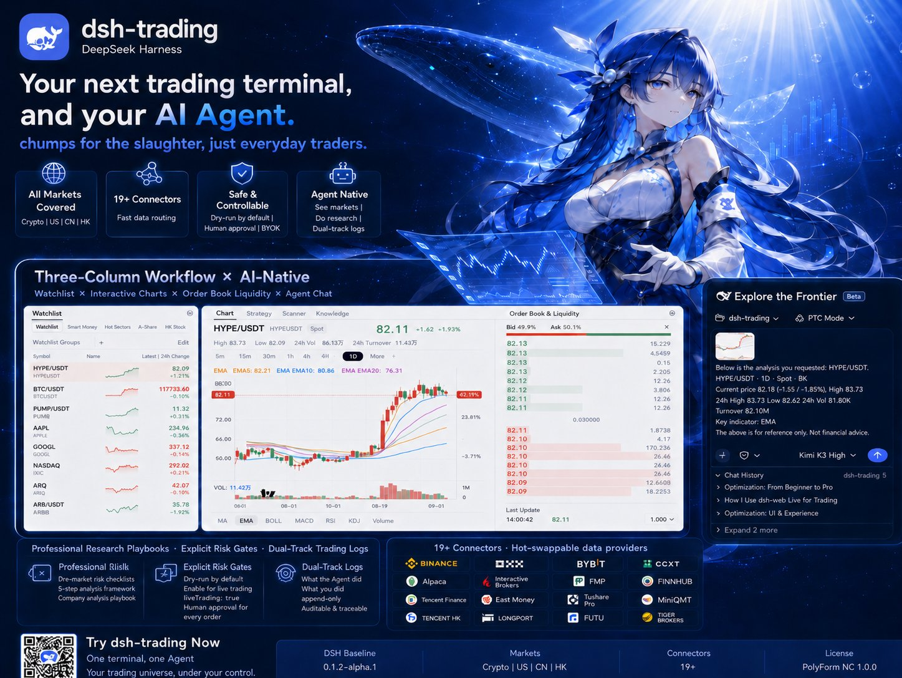

# dsh-trading — Open-Source AI Trading Terminal & Multi-Agent Quantitative Platform

> **Current Status & Handoff** / **当前状态与交接**：See [docs/current-state.md](docs/current-state.md) (accepted milestones, fail-closed invariants, documentation map).

**English** | [简体中文](README_zh.md)

**dsh-trading** is an open-source, agent-native AI trading terminal and quantitative investment research platform built on [DeepSeek Harness (DSH)](https://github.com/deepseek-ai) and the [Cordis](https://github.com/cordisjs) microkernel. It unifies **Cryptocurrency** (Binance, OKX, Bybit, CCXT), **US Equities** (Alpaca, Interactive Brokers, Yahoo Finance), **China A-Shares** (MiniQMT, Eastmoney, AkShare, Tushare), **Hong Kong Stocks** (Longbridge, Futu, Tiger), and **Chinese Commodity Futures** into a single modular workspace.

Combining TradingView Lightweight Charts v5, role-based multi-agent teams (Master, Researcher, Trader, Risk Reviewer), built-in strategy backtesting, and a zero-trust dual-track human approval gate, dsh-trading bridges the gap between deep AI reasoning and disciplined trading execution.

[Quick start](#quick-start) · [Key features](#key-features) · [Why dsh-trading](#why-dsh-trading-vs-alternatives) · [Supported markets](#supported-markets--broker-connectors) · [Agent architecture](#what-does-agent-native-mean) · [FAQ](#frequently-asked-questions-faq) · [Documentation](#documentation)



> **Your next trading terminal can also be your AI agent.**
> *No chumps for the slaughter, just everyday traders.*

<div align="center">

[](https://github.com/deepseek-ai)
[](#supported-markets--broker-connectors)
[](docs/guides/connectors-guide.md)
[](https://github.com/cordisjs)
[](https://tradingview.github.io/lightweight-charts/)
[](#zero-trust-safety--execution-discipline)
[](LICENSE)

</div>

---

## Key Features

- **All-in-One Multi-Market Workspace:** Follow Crypto (spot & perpetuals), US stocks, China A-shares, Hong Kong equities, and commodity futures in a unified watchlist with real-time quotes, order books, and corporate disclosures.
- **TradingView Charting & Market Depth Engine:** Center-stage Lightweight Charts v5 with multi-timeframe switching (5m to weekly), 15+ technical indicators (MA, EMA, MACD, RSI, Bollinger Bands, KDJ, SuperTrend, TD9), tick-by-tick trades, and crypto derivatives metrics (Open Interest, Funding Rates, Long/Short ratio).
- **Agent-Native Multi-Agent Orchestration:** A collaborative AI team (`master` lead, `instrument-researcher`, `trader`, `risk-reviewer`) that autonomously queries market data tools, performs financial statement analysis, drafts trade plans, and stresses risk scenarios.
- **Institutional Research Playbooks & Risk Checklists:** Bundled pre-trade risk checklists for every market, a 5-step crypto instrument analysis framework, institutional company valuation playbooks, and an append-only dual-track trading journal.
- **Quantitative Strategy Backtesting:** Formulate and backtest systematic trading signals with `strategy_backtest`, author custom technical indicators, and evaluate historical performance across market cycles.
- **Zero-Trust Safety & Dual-Track Approval Gate:** Dry-run simulation by default; live broker orders require explicit opt-in, interactive human confirmation, and an Ed25519 authority plane. Fail-closed in headless environments.
- **100% Local Privacy (BYOK):** Bring Your Own Keys. API keys and personal trading records live strictly on your local machine. Zero vendor lock-in, zero cloud telemetry, and zero market data redistribution.

---

First, a question for you:

Of the money you've lost trading, how much of it was lost before you had truly thought it through?

You chase a rally and become the exit liquidity. You buy the dip, and it keeps dipping. You cut the loss, and it bounces the moment you're out; you hold, and it grinds you into the deep red. (Veterans don't always dodge these either.)

Where does the problem lie? Not in luck. In discipline.

The market opens every day, and bulls and bears fight it out every day. The most dependable weapon a retail trader holds was never better information — it's discipline. A seasoned hunter waits nine-tenths of the time and strikes in the remaining tenth; most traders do the exact opposite — nine-tenths acting, one-tenth regretting.

That is why dsh-trading exists: an **agent-native trading terminal** built on [DeepSeek Harness (DSH)](https://github.com/deepseek-ai). A professional trading workflow, paired with an AI agent in sync with the market: quotes, news, and capital flow are all in its view; research follows institutional-grade playbooks; and before a real order goes out, every single one passes an approval gate that only your hand can click.

Crypto, US equities, China A-shares, Hong Kong stocks. One terminal. One agent. Nineteen-plus connectors. Zero vendor lock-in — every key stays on your machine.


---

## Why dsh-trading vs. Alternatives?

| Dimension | Traditional Trading Terminals (TradingView / Broker Apps) | Generic AI Chatbots (ChatGPT / Copilot sidebars) | **dsh-trading (Agent-Native Terminal)** |
|---|---|---|---|
| **Multi-Market Scope** | Fragmented accounts across different apps | Text-only dialogue; no live market feeds | **Single unified watchlist & dock: Crypto, US, CN, HK, Futures** |
| **Real-Time Market Depth** | Expensive subscriptions; walled gardens | Hallucinations; zero tick data or order books | **Live L2 order book, tick-by-tick trades, crypto funding rates & open interest** |
| **Terminal Integration** | None or simple external alerts | Chatbox glued next to chart; manual copy-paste | **First-class terminal citizen: AI directly drives native quote tools & code analysis** |
| **Multi-Agent Architecture** | None | Single prompt / single model | **Hierarchical team: Master (Lead) + Researcher + Quant Trader + Risk Reviewer** |
| **Investment Research** | Manual reading across disparate websites | Generic web-search summaries | **Built-in institutional skills: Market risk checklists, 5-step crypto framework, valuation playbooks** |
| **Strategy & Backtesting** | Proprietary scripting (Pine Script) in silos | Cannot run code on real market feeds | **Native `strategy_backtest` engine & indicator authoring inside the workspace** |
| **Execution Safety** | Manual clicks or opaque black-box algos | Dangerous unmonitored execution or none | **Dual-track gate: Dry-run by default, human approval for live orders, Ed25519 authority** |
| **Privacy & Credentials** | Keys stored on third-party cloud servers | Prompts & data sent to external cloud AI | **100% BYOK stored locally on your machine, zero data redistribution** |

---

## What does agent-native mean?

What do most "AI trading tools" look like? A chat box glued to the side of the chart.

Glued on, not grown in.

dsh-trading turns that relationship upside down: **the agent is a first-class citizen of the terminal, and the terminal is the agent's body.** Four things separate it from every chatbot you've used:

1. **Quotes, news, capital flow — the agent has it all.** Live quotes, the current candle, the chart series' time range with a fetch locator (so the agent pulls the same routed data itself and analyzes it in code), the computed readings of your active indicators, derivatives snapshots, plus announcements, news and a bounded fundamentals summary — all native tools the agent drives for the symbol you're watching. Missing sources are explicit; the agent is guided to verify original disclosures and fill gaps with native research tools. No more screenshot-copy-paste ritual.

2. **The agent can trade, but the gate is in your hands.** Market data, order books, derivatives positioning, news, and order placement are all native tools. Yet every order defaults to **dry-run simulation**; live routing requires an explicit `liveTrading: true` opt-in, and then each order still passes through interactive human approval. In headless environments it fails closed. One rule: no move without the gate. Nothing executes behind your back.

3. **The agent trained for this.** Domain knowledge ships as bundled skills, not model improvisation: pre-trade risk checklists for every market ([crypto](.agents/skills/crypto-risk-checklist/SKILL.md) · [US](.agents/skills/us-risk-checklist/SKILL.md) · [CN](.agents/skills/cn-risk-checklist/SKILL.md) · [HK](.agents/skills/hk-risk-checklist/SKILL.md)), a five-step [crypto instrument analysis framework](.agents/skills/crypto-instrument-analysis/SKILL.md), a full [company analysis playbook](.agents/skills/company-analysis/SKILL.md), and a [trading journal discipline](.agents/skills/trading-notes-setup/SKILL.md) that dual-tracks "what the agent did" versus "what you did" — append-only and auditable.

The risk checklist runs before every entry — a discipline most veterans never sustain in ten years (usually undone by "just this once").

4. **One master leading a role-based team.** `master` (大师) is the all-capable multi-agent team lead: it grounds every trade question in the unified holdings ledger (`holdings_list` / `holdings_stage`) and per-market balance tools, pulls the user knowledge base first, then decomposes the task and delegates specialist work to persona-pinned subagents — instrument analysis to the researcher (`researcher_subagent`), trading-plan drafting to the trader (`trader_subagent`), plan review to the risk reviewer (`risk_reviewer_subagent`) — dispatching project skills by task type (analysis frameworks, market risk checklists, strategy paradigms with `strategy_backtest`, dynamic packages for one-off cross-instrument aggregation) before cross-checking and integrating a single conclusion. Cross-market overviews and order execution it can do itself, still dry-run by default behind the approval gate; delegates deliver analysis text only — execution stays with the master behind the gate. Beneath it: `trader` (交易员) for trading plans and gated execution, `instrument-researcher` (标的分析研究员) for disclosures, fundamentals and valuation, `risk-reviewer` (风险审查员) for exposure, stress scenarios and rejection conditions. Every role prioritizes project knowledge, news/announcements and fundamentals tools. Research and risk retain read-only quotes/candles but mount no order/cancel connectors; subagents inherit the session toolset with a persona pinning their duties — shared host tools remain visible, so role scoping is not a separate security sandbox.

The base installer generates these four roles from enabled market bundles, including partial-market installations; the deployment default for new sessions is 大师 (master) — overridable per user in settings. Unmodified managed legacy market presets move to a sibling `.legacy-backup` root; custom, unstamped or extended directories remain untouched. No user preset data is deleted.

---

## The terminal itself must be real software first

A shoddy terminal makes even the smartest agent an armchair general.

- **Center-stage charting:** Lightweight Charts v5 with multi-timeframe switching (5m to weekly); MA / EMA / BOLL / MACD / RSI / KDJ / SuperTrend, all visually editable; strategy signal markers, knowledge-event pins, and drag-to-measure range statistics.
- **Real market depth:** Live order book with buy/sell pressure bars, tick-by-tick trades, and a derivatives cockpit — open interest, funding rates with settlement countdown, long/short ratio, taker flow. Quote and fund-flow data are native tools the agent queries on demand.
- **Cross-market watchlist:** Crypto perps next to AAPL next to 牧原股份, with sparklines and real-time quotes. Your whole risk universe in one dock.

### The operations surface is built in

- **Usage statistics:** DSH's built-in *Performance & Usage* settings surface each session's live token stream and spend, resolved host-side so credentials never reach the browser.
- **Plugin manager:** The Plugins section gains a manager tab: install from an npm spec or a git URL, flip next-start enablement, check and apply verified updates (gated on each package's declared minimum DSH version), roll back conflicting installs, and hand failures to a repair conversation. Writes are loopback-only and ride the official CLI; the desktop build ships a `dsh` shim so this works without a global install.
- **Per-model capability declarations:** Every custom `llm-pi-ai` provider card carries a capability area: declare image input and reasoning efforts per model (including the exact wire value each level sends), or archive a provider to take its route down without touching its stored keys.

---

## Supported Markets & Broker Connectors

dsh-trading connects to 19+ market data providers, cryptocurrency exchanges, and licensed stock brokers:

| Market | Supported Providers & Broker Connectors | Coverage & Data Plane Capabilities | Execution & Auth Mode |
|---|---|---|---|
| **Cryptocurrency** | **Binance**, **OKX** (Paper/Live), **Bybit**, **CCXT** (spot-only aggregation across nine exchanges) | Binance / OKX / Bybit: spot & perpetual swap quotes, depth, historical candles, open interest, funding rates, long/short ratio. CCXT: spot quotes and candles on nine direct routes (binance, okx, bybit, gateio, kucoin, kraken, coinbase, bitfinex, htx) with per-venue candle interval mapping — no depth, no derivatives, no account reads, and perpetual `-SWAP` symbols are rejected | REST polling (no connector ships a WebSocket transport), BYOK API keys; OKX contract trading with auto ctVal unit conversion |
| **US Equities** | **Alpaca** (Paper/Live), **Interactive Brokers (IBKR)**, **Yahoo Finance**, **FMP**, **Finnhub**, **Polygon.io** | Real-time quotes, historical K-lines, balance sheet & cash flow fundamentals, SEC filings, analyst sentiment | Official Broker REST/WS APIs, BYOK credentials; Yahoo Finance free public endpoints |
| **China A-Shares** | **MiniQMT (QMT / XtQuant)**, **Tencent Finance**, **Eastmoney (东方财富)**, **HiThink (同花顺/富遥)**, **Tushare Pro**, **AkShare** | Real-time L1 quotes, auction prices, daily K-lines, sector capital flow, valuation metrics | Local MiniQMT broker client gateway for live execution; public REST & token authentication |
| **Hong Kong Stocks** | **Longbridge (长桥 OpenAPI)**, **Futu OpenD (富途)**, **Tiger (老虎证券 OpenAPI)**, **Tencent HK** | Real-time quotes, Level 2 market data, warrants & CBBCs | Licensed Broker OpenAPI / Gateway execution; Tencent HK public quotes |
| **Commodity Futures** | **HiThink (同花顺/富遥期货)** | Daily K-lines, intraday tick points, commodity & index futures data plane | Institutional REST API (data-plane only) |

**Hot-swappable data planes:** Not happy with a data source? Swap it. **Settings → Trading** routes any market to any installed provider: the quote panel re-routes on save, agent sessions pick it up on their next turn — no restarts, no config archaeology.


---

## Zero-Trust Safety & Execution Discipline

The formula of trading has always been: **study + waiting + decisiveness + patience = survival.**

The tool cannot wait for you, and it cannot be patient for you. But it can hold the gate in between:

1. **Dry-run by default:** Every order and cancellation tool executes in simulation mode unless you explicitly flip `liveTrading: true`.
2. **Interactive human approval for live orders:** DSH's approval layer intercepts live routing; headless execution sessions fail closed.
3. **100% BYOK (Bring Your Own Keys):** API keys and broker credentials live in your local environment variables or local configs. Nothing is bundled, relayed, or uploaded to any third-party server.
4. **Zero data re-distribution:** Market data is fetched strictly for your individual usage under each provider's Terms of Service. Nothing is scraped or cached for resale or sharing.

Without your signature, not a single cent moves.

---

## Quick Start

### 1. Installation

Trading runs in its own dedicated DSH home directory (`~/.dsh-trading`) so it never mixes with your main dsh web home (`~/.dsh`). Every dsh-trading package resolves paths through `$DSH_HOME`.

```sh
# Install into a dedicated DSH profile (pick your markets)
export DSH_HOME=~/.dsh-trading
dsh plugin --profile trading-web add @dshtrading/base @dshtrading/crypto @dshtrading/us

# Or install all markets at once
dsh plugin --profile trading-web add @dshtrading/base @dshtrading/crypto @dshtrading/us @dshtrading/cn @dshtrading/hk

# Serve the browser UI in this profile (run once): insert the in-box web host layer
node -e "const f=(process.env.DSH_HOME||require('os').homedir()+'/.dsh')+'/profiles/trading-web/package.json',fs=require('fs'),m=JSON.parse(fs.readFileSync(f,'utf8'));m.dsh.profile.bundles.includes('@deepseek-ai/dsh-web-app')||m.dsh.profile.bundles.splice(1,0,'@deepseek-ai/dsh-web-app');fs.writeFileSync(f,JSON.stringify(m,null,2)+'\n')"
```

### 2. Launch

```sh
# From a repository checkout: install the wrapper once, then launch
cp scripts/home/dsh-trading ~/.local/bin/ && chmod +x ~/.local/bin/dsh-trading
dsh-trading --profile trading-web        # serves on port 8888 by default

# Installed from npm only? The wrapper sets DSH_HOME and the 8888 default:
DSH_HOME=~/.dsh-trading dsh --profile trading-web --port 8888
```

Profiles ship for different operational needs:

| Profile | Interface Surface | Included Bundles |
|---|---|---|
| `trading-web` | Browser GUI (recommended) | dsh-base + dsh-web-app + base + gui + bot-api + crypto + us + cn + hk + futures + global |
| `trading-dev` | Headless, single market | dsh-base + dsh-headless + base + crypto |
| `trading-all` | Headless, all markets | dsh-base + dsh-headless + base + all + cn + crypto + hk + us |
| `trading-bot` | Bot surface: agent host + `/dshtrading/api`, loopback-only | dsh-base + base + bot + bot-api + crypto — source in the private [dsh-trading-bot](https://github.com/zhu1090093659/dsh-trading-bot) repo |

Open the printed URL in your browser: watchlist on the left, chart in the center, and your AI trading agent on the right. Create a new conversation → select a market preset → ask the agent: *"What do you see in the market today?"*

### 3. Build From Source

```sh
pnpm install && pnpm build && pnpm test   # Node per engines (^22.19.0 || >=24.0.0), pnpm 11
./scripts/refresh-profile.sh              # Rebuild profile file: copies (default trading-web)
```

See [docs/ops/running.md](docs/ops/running.md) for the complete running, profile, and refresh contract.

---

## Architecture at a Glance

A modular, layered [Cordis](https://github.com/cordisjs) microkernel architecture where markets compose cleanly without interference:

```
@dshtrading/base          ← Core: account/order/quote contracts, approval gate, GUI shell
├── @dshtrading/crypto    ← Binance / OKX / Bybit / CCXT + skills + presets
├── @dshtrading/us        ← Yahoo / Alpaca / FMP / Finnhub / Polygon / IBKR + skills + presets
├── @dshtrading/cn        ← Tencent / Eastmoney / Tushare / AkShare / MiniQMT + skills + presets
└── @dshtrading/hk        ← Tencent HK / Longbridge / Futu / Tiger + skills + presets
```

Six architectural invariants safeguard the system:
1. Bundle patches are strictly **insert-only**.
2. Domain knowledge lives in **reusable skills**, not hardcoded prompt hacks.
3. Dual-track order gates protect every trade.
4. Shared code must serve **≥2 markets** before entering base.
5. **Zero data re-distribution** under provider Terms of Service.
6. The GUI shell is replaceable; data contracts are immutable.

### Live-Trading Authority Plane (Shipped & Off by Default)

- **Live-trading authority plane:** Live execution toggles do not reside on the agent-writable path. A human-signed cryptographic grant (Ed25519) is the sole mechanism that can unlock live order routing, and the agent side never accesses signing material. This ships in `packages/authority`, alongside the public GUI market-data bridge (`packages/bot-api`).
- **Autonomous bot plane boundary:** The autonomous trading plane (background bot daemon, automated mandate enforcement, web cockpit, native iOS observation client, and systemd units) lives in the private satellite repository [dsh-trading-bot](https://github.com/zhu1090093659/dsh-trading-bot). This public repository retains only the clean seams necessary for independent building.

---

## Data Sources & Terms

| Market | Default Source | Boundary & Compliance |
|---|---|---|
| **US Equities** | Yahoo Finance / Alpaca | Yahoo public endpoints (individual noncommercial use); Alpaca official Paper/Live APIs |
| **China A-Shares** | Tencent Finance / Eastmoney / HiThink (Fuyao) | Public endpoints; HiThink REST API for daily K, fundamentals & auction data; live execution via local MiniQMT broker gateway |
| **Futures (CN)** | HiThink (Fuyao) | HiThink REST API for daily K, intraday points, commodity & index futures; data plane only |
| **Hong Kong** | Tencent HK / Longbridge | Public endpoints; licensed broker OpenAPI/Gateway for execution |
| **Crypto** | Binance / OKX | Official exchange APIs; OKX paper trading with BYOK credentials |
| **Crypto Fundamentals** | CoinCap | Public REST, individual use only — no redistribution, no bulk scraping |

---

## Frequently Asked Questions (FAQ)

### Is dsh-trading an autonomous trading bot?

It is an **AI-assisted trading terminal**, not an unattended live-trading bot. Order tools default to dry-run simulation. Live execution requires explicit `liveTrading: true` opt-in and interactive human approval; headless sessions fail closed. Dry-run simulation is distinct from exchange or broker paper trading.

### Which exchanges, brokers, and market data APIs can I connect?

dsh-trading supports 19+ connectors: **Binance, OKX, Bybit, CCXT (spot quotes and candles on nine direct routes: binance / okx / bybit / gateio / kucoin / kraken / coinbase / bitfinex / htx)** for crypto; **Alpaca, Interactive Brokers (IBKR), Yahoo Finance, FMP, Finnhub, Polygon.io** for US stocks; **MiniQMT, Tencent Finance, Eastmoney, HiThink, Tushare Pro, AkShare** for China A-shares; **Longbridge, Futu OpenD, Tiger OpenAPI** for Hong Kong stocks; and **HiThink** for commodity futures. See the [connector configuration guide](docs/guides/connectors-guide.md).

### Which AI models can be used with dsh-trading?

dsh-trading runs on DeepSeek Harness (DSH), supporting **DeepSeek (V3 / R1)**, Anthropic Claude, OpenAI GPT-4o, and custom OpenAI-compatible endpoints or local models (via Ollama / vLLM). You can configure reasoning effort, image capabilities, and token budgets per model in settings.

### Do I need API keys to use the terminal?

Some public market data sources (such as Tencent Finance, Eastmoney, and Yahoo Finance) work out of the box without keys. Authenticated data services, licensed brokers, cryptocurrency exchanges, and your selected AI provider require separate credentials. You supply your own keys (**BYOK**); credentials remain strictly on your local machine.

### Can I backtest trading strategies and build custom indicators?

Yes. The terminal includes a native `strategy_backtest` engine alongside classical quantitative paradigms (Donchian breakout, RSI mean-reversion, EMA crossover, Bollinger Bands reversion, 200-day trend following, momentum). You can also author custom indicators (SuperTrend, TD9, OBV+MA) that render directly onto the chart.

### Is dsh-trading free for commercial use?

No. The [PolyForm Noncommercial 1.0.0 license](LICENSE) permits personal, educational, and research use free of charge. Commercial use requires prior written authorization. The software does not provide investment advice or guarantee trading returns.

---

## Documentation

- [Documentation Index](docs/README.md)
- [Running, Profiles & Development](docs/ops/running.md)
- [Connector Onboarding & Configuration](docs/guides/connectors-guide.md)
- [New Connector Playbook](docs/guides/connector-playbook.md)
- [Skills Architecture Guide](docs/guides/skills-guide.md)
- [Symbol Vocabulary Standard](docs/guides/symbol-vocabulary.md)
- [Exchange Routing & Data Plane](docs/guides/exchange-routing.md)
- [Analysis & Quantitative Roadmap](docs/roadmap/analysis-roadmap.md)
- [Architecture Decision Log (Spikes)](spikes/REVIEW-LOG.md)
- [简体中文说明](README_zh.md)

## Friendly Links

- [dsh-web](https://github.com/zhu1090093659/dsh-web)
- [LINUX DO](https://linux.do)

## Community

**QQ Group: DSH Trading 交流群（群号 `319737695`）** — questions, feedback, and everything dsh-trading. Scan with QQ to join:

<div align="center">


</div>

---

## One Last Word

Tools are dead things; discipline is alive. The finest terminal cannot press buy for you, and it should not — but it can make sure that every time your hand does move, the thinking has already happened.

Go experience it. Go make the mistakes. Go review your trades. The road is long — onwards, together.

**This project is software, not investment advice. Markets carry risk — trade with care.**

## License

[PolyForm Noncommercial 1.0.0](LICENSE) — free for personal study, research, and noncommercial use. **Commercial use requires prior written authorization**: open a GitHub issue or contact <chunlinzhu666@gmail.com>.

> 本项目采用 [PolyForm Noncommercial 1.0.0](LICENSE) 许可：非商业用途免费；商业用途须事先取得书面授权（[chunlinzhu666@gmail.com](mailto:chunlinzhu666@gmail.com) 或 GitHub Issue）。

---

### Topics & Search Tags

`ai-trading` · `algorithmic-trading` · `quantitative-finance` · `deepseek` · `deepseek-harness` · `trading-terminal` · `lightweight-charts` · `technical-analysis` · `crypto-trading` · `binance` · `okx` · `bybit` · `ccxt` · `stock-trading` · `alpaca` · `interactive-brokers` · `miniqmt` · `futu` · `longbridge` · `multi-agent-systems` · `backtesting` · `risk-management`
