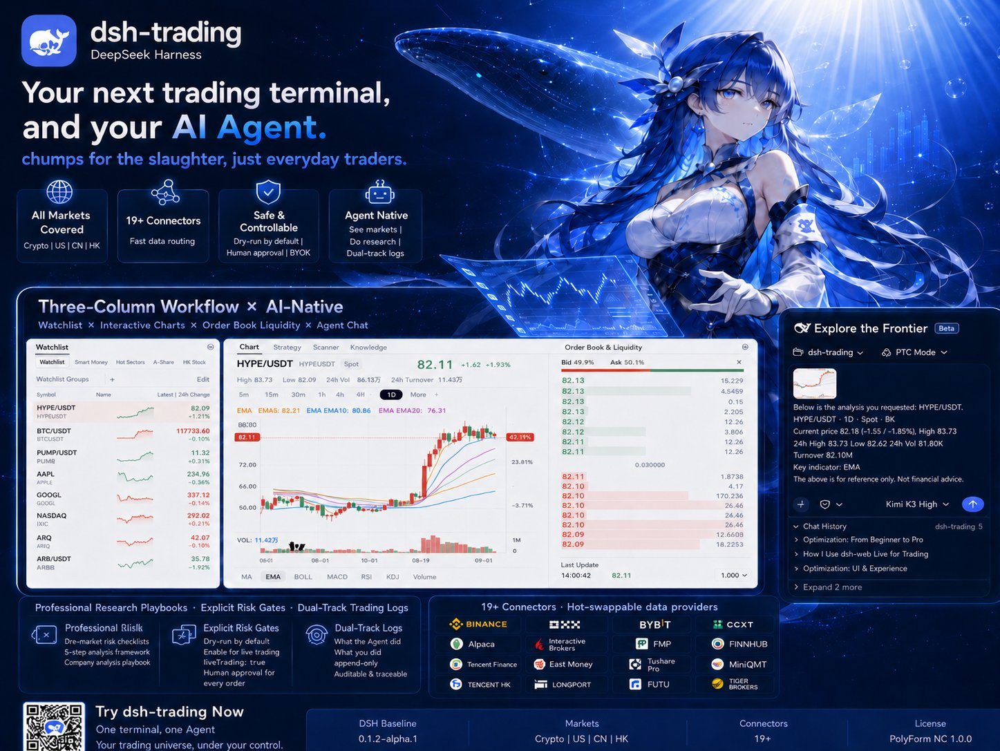
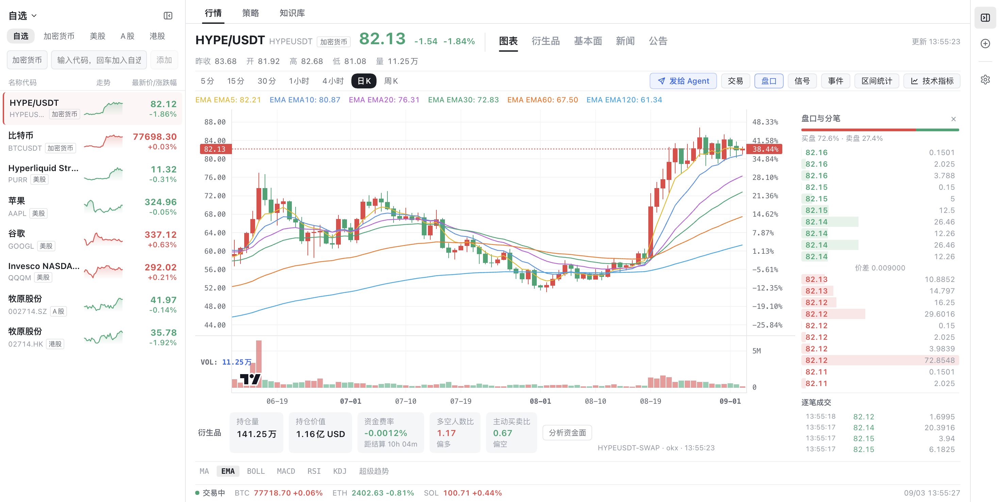
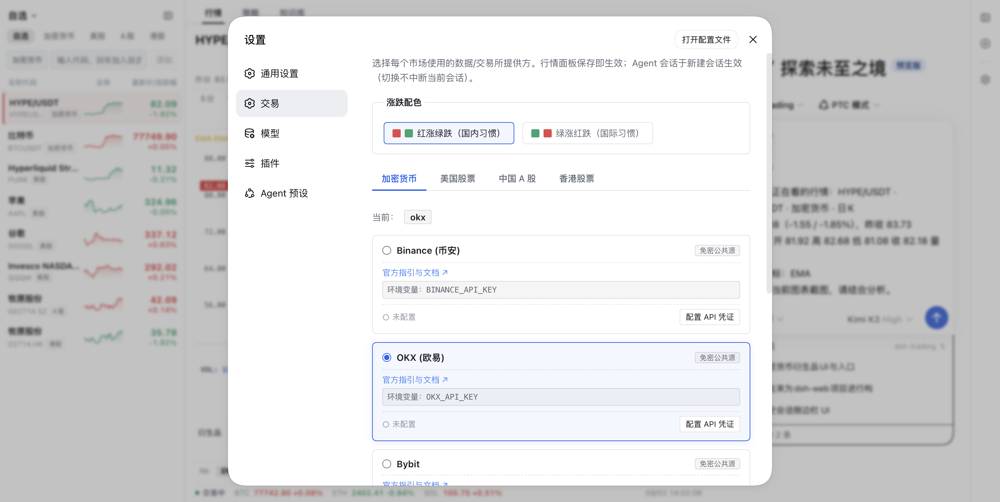
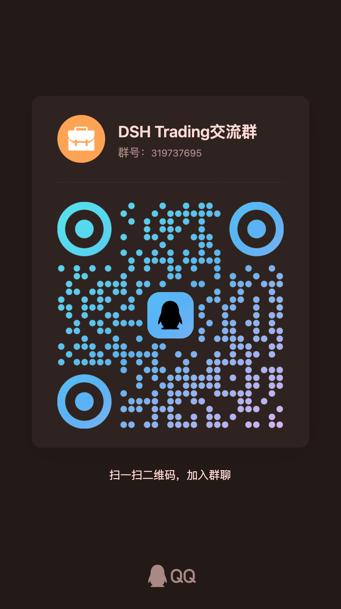

# dsh-trading — открытый AI-торговый терминал для всех рынков и мультиагентная платформа количественных инвестиционных исследований

> **Текущий статус и передача дел** / **Current Status & Handoff**: см. [docs/current-state.md](docs/current-state.md) — принятые этапы, обязательные fail-closed инварианты, незавершённое и жёсткие остановки, команды проверки, карта документации.

[English](README.md) | [简体中文](README_zh.md) | **Русский**

**dsh-trading** — открытый, agent-native AI-торговый терминал и платформа количественных инвестиционных исследований, построенная на [DeepSeek Harness (DSH)](https://github.com/deepseek-ai) и микроядерной архитектуре [Cordis](https://github.com/cordisjs). В одном модульном рабочем пространстве объединены **криптовалюты** (Binance, OKX, Bybit, CCXT), **акции США** (Alpaca, Interactive Brokers, Yahoo Finance), **акции A-рынка Китая** (MiniQMT, Eastmoney, Tencent Finance, HiThink, AkShare, Tushare), **акции Гонконга** (Longbridge, Futu, Tiger) и **китайские товарные фьючерсы**.

Терминал сочетает графики TradingView Lightweight Charts v5, ролевую мультиагентную команду (Мастер, Исследователь инструментов, Трейдер, Ревьюер рисков), встроенный бэктест стратегий и двухконтурный шлюз ручного подтверждения с нулевым доверием — благодаря чему глубокое AI-рассуждение доводится до дисциплинированного исполнения сделок.

[Быстрый старт](#быстрый-старт) · [Ключевые возможности](#ключевые-возможности) · [Почему dsh-trading](#почему-dsh-trading-а-не-альтернативы) · [Поддерживаемые рынки](#поддерживаемые-рынки-и-коннекторы-брокеров) · [Архитектура агента](#что-значит-agent-native) · [FAQ](#часто-задаваемые-вопросы-faq) · [Документация](#документация)



> **Твой следующий торговый терминал может быть и твоим AI-агентом.**
> *Не пушечное мясо — просто обычные трейдеры.*

<div align="center">

[](https://github.com/deepseek-ai)
[](#поддерживаемые-рынки-и-коннекторы-брокеров)
[](docs/guides/connectors-guide.md)
[](https://github.com/cordisjs)
[](https://tradingview.github.io/lightweight-charts/)
[](#безопасность-с-нулевым-доверием-и-дисциплина-исполнения)
[](LICENSE)

</div>

---

## Ключевые возможности

- **Единое мультирыночное рабочее пространство:** криптовалюты (спот и бессрочные контракты), акции США, акции A-рынка Китая, акции Гонконга и китайские товарные фьючерсы — в одном вотчлисте с единой плоскостью данных: котировки L1/L2, K-линии разных таймфреймов, глубина стакана, корпоративные раскрытия и объявления.
- **Графики TradingView и движок глубины рынка:** в центре внимания — Lightweight Charts v5 с переключением таймфреймов от 5 минут до недели, 15+ технических индикаторов (MA, EMA, MACD, RSI, Bollinger Bands, KDJ, SuperTrend, TD9), тиковые сделки и метрики крипто-деривативов (открытый интерес, ставки финансирования, соотношение лонг/шорт).
- **Agent-native мультиагентная оркестрация:** совместная AI-команда (`master`-лид, `instrument-researcher`, `trader`, `risk-reviewer`), которая автономно опрашивает рыночные инструменты, разбирает финансовую отчётность, готовит черновики торговых планов и прогоняет стресс-сценарии риска.
- **Институциональные исследовательские плейбуки и риск-чеклисты:** встроенные предторговые риск-чеклисты для каждого рынка, 5-шаговый фреймворк анализа крипто-инструмента, институциональные методики оценки компаний и append-only двухконтурный аудируемый торговый журнал.
- **Количественный бэктест стратегий:** формулируйте и проверяйте системные торговые сигналы через `strategy_backtest` (в комплекте 6 классических количественных парадигм, полный список — в FAQ), создавайте собственные индикаторы (SuperTrend, TD9, OBV+MA) с отрисовкой прямо на графике и оценивайте исторические результаты на рыночных циклах.
- **Безопасность с нулевым доверием и двухконтурный шлюз подтверждения:** по умолчанию — 100% dry-run симуляция; живые ордера брокеру требуют явного opt-in, интерактивного подтверждения человеком и плоскости полномочий Ed25519. В headless-окружении — fail-closed, никаких неконтролируемых ордеров.
- **100% локальная приватность (BYOK):** Bring Your Own Keys — API-ключи и личная торговая история остаются строго на вашей машине. Ноль vendor lock-in, ноль облачной телеметрии и ноль перераспространения рыночных данных: без перепродажи и без кэширования для раздачи.

---

Для начала — вопрос:

Из денег, которые вы потеряли на трейдинге, какая доля была потеряна до того, как вы действительно всё продумали?

Гонитесь за ралли — и становитесь чьей-то ликвидностью на выходе. Покупаете просадку — она проседает дальше. Режете убыток — рынок отрастает ровно в момент, когда вы вышли; держите — вас вматывает в глубокий минус. (Ветераны тоже не всегда этого избегают.)

В чём проблема? Не в удаче. В дисциплине.

Рынок открывается каждый день, и быки с медведями выясняют отношения каждый день. Самое надёжное оружие розничного трейдера — это не «лучшая информация», а дисциплина. Опытный охотник девять десятых времени ждёт и действует в оставшуюся десятую; большинство трейдеров делает ровно наоборот: девять десятых — действия, одна десятая — сожаления.

Поэтому и существует dsh-trading — **agent-native торговый терминал**, построенный на [DeepSeek Harness (DSH)](https://github.com/deepseek-ai). Профессиональный торговый workflow плюс AI-агент в такт рынку: котировки, новости и потоки капитала — всё в его поле зрения; исследования идут по институциональным плейбукам; а перед каждым реальным ордером стоит шлюз подтверждения, который нажимаете только вы.

Криптовалюты, акции США, A-рынок Китая, акции Гонконга. Один терминал. Один агент. 19+ коннекторов. Ноль vendor lock-in — каждый ключ остаётся на вашей машине.



---

## Почему dsh-trading, а не альтернативы?

| Критерий | Классические торговые терминалы (TradingView / приложения брокеров) | Универсальные AI-чаты (ChatGPT / Copilot-сайдбары) | **dsh-trading (agent-native терминал)** |
|---|---|---|---|
| **Мультирыночный охват** | Аккаунты разбросаны по разным приложениям | Только текстовый диалог, без живых рыночных потоков | **Единый вотчлист и док: крипто, США, A-рынок, Гонконг, фьючерсы** |
| **Глубина рынка в реальном времени** | Дорогие подписки и закрытые острова данных | Галлюцинации; ноль тиковых данных и стакана | **Живой L2-стакан, тиковые сделки, открытый интерес (OI), ставки финансирования и long/short по крипте** |
| **Интеграция с терминалом** | Нет или простые внешние алерты | Чат-бокс приклеен к графику, ручной copy-paste | **Полноценный житель терминала: AI напрямую управляет нативными инструментами котировок и анализирует данные кодом** |
| **Мультиагентная архитектура** | Нет | Один промпт / одна модель | **Иерархическая команда: Мастер (лид) + Исследователь инструментов + Трейдер + Ревьюер рисков (право вето)** |
| **Инвестиционные исследования** | Ручное чтение по разрозненным сайтам | Обобщения из общего веб-поиска | **Встроенные институциональные skills: рыночные риск-чеклисты, 5-шаговый крипто-фреймворк, плейбуки оценки, двухконтурные торговые журналы** |
| **Стратегии и бэктест** | Проприетарные скрипты (Pine Script) в изоляции | Не могут исполнять код на реальных рыночных потоках | **Нативный движок `strategy_backtest` и создание индикаторов прямо в рабочем пространстве** |
| **Безопасность исполнения** | Ручные клики или непрозрачные чёрные ящики | Опасное неконтролируемое исполнение или его отсутствие | **Двухконтурный шлюз: dry-run по умолчанию, подтверждение человеком для живых ордеров, полномочия Ed25519** |
| **Приватность и ключи** | Ключи на облачных серверах третьих лиц | Промпты и данные уходят в облако внешнего AI | **100% BYOK на локальной машине, ноль перераспространения данных** |

---

## Что значит «agent-native»?

Как выглядит большинство «AI-инструментов для трейдинга»? Чат-бокс, приклеенный сбоку к графику.

Приклеенный — а не выросший изнутри.

dsh-trading переворачивает это отношение: **агент — полноправный житель терминала, а терминал — тело агента.** Четыре вещи отделяют его от любого чат-бота, которым вы пользовались:

1. **Котировки, новости, потоки капитала — у агента есть всё.** Живые котировки, текущая свеча, временной диапазон серии графика с локатором загрузки (чтобы агент сам тянул те же маршрутизированные данные и анализировал их кодом), посчитанные значения активных индикаторов, снимки деривативов, а также объявления, новости и ограниченная сводка фундаментальных показателей — всё это нативные инструменты, которыми агент управляет для наблюдаемого вами инструмента. Отсутствующие источники обозначаются явно, а агент направляется проверять первичные раскрытия и закрывать пробелы нативными исследовательскими инструментами. Больше никакого ритуала «скриншот → копировать → вставить».

2. **Агент умеет торговать, но шлюз — в ваших руках.** Рыночные данные, стакан заявок, позиционирование по деривативам, новости и размещение ордеров — всё это нативные инструменты. При этом каждый ордер по умолчанию идёт в **dry-run симуляцию**; живая маршрутизация требует явного opt-in `liveTrading: true`, и затем каждый ордер всё равно проходит интерактивное подтверждение человеком. В headless-окружениях — fail-closed. Правило одно: ни шагу без шлюза. Ничего не исполняется у вас за спиной.

3. **Агента этому обучили.** Предметное знание поставляется встроенными skills, а не импровизацией модели: предторговые риск-чеклисты для каждого рынка ([крипто](.agents/skills/crypto-risk-checklist/SKILL.md) · [США](.agents/skills/us-risk-checklist/SKILL.md) · [A-рынок](.agents/skills/cn-risk-checklist/SKILL.md) · [Гонконг](.agents/skills/hk-risk-checklist/SKILL.md)), 5-шаговый [фреймворк анализа крипто-инструмента](.agents/skills/crypto-instrument-analysis/SKILL.md), полный [плейбук анализа компании](.agents/skills/company-analysis/SKILL.md) и [дисциплина торгового журнала](.agents/skills/trading-notes-setup/SKILL.md), которая двухконтурно фиксирует «что сделал агент» и «что сделали вы» — append-only и с аудитом.

Риск-чеклист прогоняется перед каждым входом — дисциплина, которую большинство ветеранов не выдерживает и за десять лет (обычно её ломает фраза «только в этот раз»).

4. **Один мастер ведёт ролевую команду.** `master` («Мастер») — универсальный лид мультиагентной команды: любой торговый вопрос он строит, опираясь на единый реестр позиций (`holdings_list` / `holdings_stage`) и балансовые инструменты по каждому рынку, сначала обращается к пользовательской базе знаний, затем декомпозирует задачу и делегирует специализированную работу субагентам с закреплённой персоной — анализ инструмента исследователю (`researcher_subagent`), черновик торгового плана трейдеру (`trader_subagent`), проверку плана ревьюеру рисков (`risk_reviewer_subagent`) — и точечно назначает проектные skills по типу задачи (аналитические фреймворки, рыночные риск-чеклисты, стратегические парадигмы — `trading-strategy-paradigms` с `strategy_backtest`, динамические пакеты для разовой агрегации по нескольким инструментам), после чего сверяет и сводит всё в единый вывод. Межрыночные обзоры и исполнение ордеров он может делать сам — по-прежнему dry-run по умолчанию и живые сделки через шлюз; делегаты отдают только аналитический текст — исполнение остаётся за мастером и всегда проходит через шлюз. Под ним: `trader` («Трейдер») — торговые планы и исполнение через шлюз; `instrument-researcher` («Исследователь инструментов») — раскрытия, фундаментал, оценка и контраргументы; `risk-reviewer` («Ревьюер рисков») — экспозиция, стресс-сценарии и условия отклонения (вето). Каждая роль в приоритете использует базу знаний проекта, инструменты новостей/объявлений и фундаментальных данных. Исследование и риск сохраняют read-only-котировки/K-линии, но не подключают коннекторы для ордеров и их отмены: субагенты наследуют набор инструментов сессии с персоной, закрепляющей их обязанности, — общие host-инструменты остаются видимыми, поэтому ролевое разделение не является отдельной песочницей безопасности.

Установщик base генерирует эти четыре роли из включённых рыночных bundle-ов, включая частичные установки рынков; при поставке по умолчанию новые сессии открываются в 大师 (master) — пользователь может переопределить это в настройках. Немодифицированные управляемые легаси-пресеты рынков переезжают в соседний корень `.legacy-backup`; кастомные, не проштампованные или расширенные директории остаются нетронутыми. Пользовательские данные пресетов не удаляются.

---

## Терминал прежде всего должен быть настоящим инструментом

Халтурный терминал превращает в кабинетного генерала даже самого умного агента.

- **График в центре внимания:** Lightweight Charts v5 с переключением таймфреймов (5m–неделя); MA / EMA / BOLL / MACD / RSI / KDJ / SuperTrend — все визуально редактируются; маркеры сигналов стратегии, пины событий базы знаний и статистика диапазона, снимаемая перетаскиванием.
- **Реальная глубина рынка:** живой стакан заявок с полосами давления покупателей и продавцов, тиковые сделки и кокпит деривативов — открытый интерес, ставки финансирования с обратным отсчётом до расчётов, соотношение лонг/шорт, поток тейкеров. Котировки и данные потоков капитала — нативные инструменты, которые агент опрашивает по требованию.
- **Кросс-рыночный вотчлист:** крипто-перпы рядом с AAPL рядом с 牧原股份, со спарклайнами и живыми котировками. Вся ваша риск-вселенная в одном доке.

### Операционная поверхность встроена

- **Статистика использования:** встроенный в DSH раздел настроек *Performance & Usage* показывает живой поток токенов и расходы каждой сессии; вычисления выполняются на стороне хоста, так что учётные данные не попадают в браузер.
- **Менеджер плагинов:** в разделе Plugins появляется вкладка менеджера: установка из npm-спеки или git-URL, переключение включения на следующий запуск, проверка и применение проверенных обновлений (шлюз по объявленной минимальной версии DSH каждого пакета), откат конфликтующих установок и передача сбоев в ремонтную беседу. Записи — только loopback и через официальный CLI; десктопная сборка поставляет шим `dsh`, так что это работает без глобальной установки.
- **Декларации возможностей на модель:** в каждой карточке кастомного провайдера `llm-pi-ai` есть область возможностей: объявите ввод изображений и уровни reasoning по каждой модели (включая точное wire-значение, которое отправляет каждый уровень) или заархивируйте провайдера, чтобы убрать его маршрут, не трогая сохранённые ключи.

---

## Поддерживаемые рынки и коннекторы брокеров

dsh-trading подключается к 19+ поставщикам рыночных данных, криптобиржам и лицензированным фондовым брокерам:

| Рынок | Поддерживаемые провайдеры и коннекторы брокеров | Покрытие и возможности плоскости данных | Режим исполнения и авторизации |
|---|---|---|---|
| **Криптовалюты** | **Binance**, **OKX** (Paper/Live), **Bybit**, **CCXT** (агрегация только спот по девяти биржам) | Binance / OKX / Bybit: котировки спота и бессрочных свопов, глубина, исторические K-линии, открытый интерес, ставки финансирования, long/short. CCXT: спот-котировки и K-линии на девяти прямых маршрутах (binance, okx, bybit, gateio, kucoin, kraken, coinbase, bitfinex, htx) с маппингом интервалов K-линий по каждой площадке; без глубины, без деривативов, без чтения аккаунта; бессрочные `-SWAP`-символы отклоняются | REST-опрос (polling) — ни один коннектор не поставляет WebSocket-транспорт, BYOK API-ключи; торговля контрактами OKX с автоматическим пересчётом единиц ctVal |
| **Акции США** | **Alpaca** (Paper/Live), **Interactive Brokers (IBKR)**, **Yahoo Finance**, **FMP**, **Finnhub**, **Polygon.io** | Живые котировки, исторические K-линии, фундаментал баланса и денежных потоков, SEC-филинги, аналитический сентимент | Официальные REST/WS API брокеров, BYOK-учётные данные; бесплатные публичные эндпоинты Yahoo Finance |
| **A-рынок Китая** | **MiniQMT (QMT / XtQuant)**, **Tencent Finance**, **Eastmoney (东方财富)**, **HiThink (同花顺/富遥)**, **Tushare Pro**, **AkShare** | Живые L1-котировки, цены аукциона, дневные K-линии, поток капитала по секторам, метрики оценки | Локальный шлюз клиента брокера MiniQMT для живого исполнения; публичные REST-эндпоинты без ключа (Tencent, Eastmoney, AkShare) и токен-аутентификация (HiThink, Tushare Pro) |
| **Акции Гонконга** | **Longbridge (长桥 OpenAPI)**, **Futu OpenD (富途)**, **Tiger (老虎证券 OpenAPI)**, **Tencent HK** | Живые котировки, рыночные данные Level 2, варранты и CBBC | Исполнение через OpenAPI/шлюз лицензированного брокера; публичные котировки Tencent HK |
| **Товарные фьючерсы** | **HiThink (同花顺/富遥期货)** | Дневные K-линии, внутридневные тиковые точки, коды основных непрерывных контрактов (например, `RB00.SHF`) и данные по товарным и индексным фьючерсам | Институциональный REST API (только плоскость данных, без исполнения) |

**Горячая замена плоскостей данных:** не нравится источник данных? Замените. В разделе **Settings → Trading** любой рынок маршрутизируется на любого установленного провайдера: панель котировок переключается после сохранения, а сессии агента подхватывают новый маршрут на следующем ходу — без перезапусков и без археологии по конфигам.



---

## Безопасность с нулевым доверием и дисциплина исполнения

Формула трейдинга всегда была такой: **изучение + ожидание + решительность + терпение = выживание.**

Инструмент не может ждать за вас и не может быть терпеливым за вас. Но он может удержать шлюз между вами и рынком:

1. **Dry-run по умолчанию:** каждый инструмент размещения и отмены ордера исполняется в режиме симуляции, пока вы явно не включите `liveTrading: true`.
2. **Интерактивное подтверждение человеком для живых ордеров:** слой подтверждения DSH перехватывает живую маршрутизацию; headless-сессии исполнения работают fail-closed.
3. **100% BYOK (Bring Your Own Keys):** API-ключи и учётные данные брокеров живут в ваших локальных переменных окружения или локальных конфигах. Ничего не встраивается в пакет, не ретранслируется и не загружается на сторонние серверы.
4. **Ноль перераспространения данных:** рыночные данные запрашиваются строго для вашего индивидуального использования в рамках Terms of Service каждого провайдера. Ничего не скрейпится и не кэшируется для перепродажи или обмена.

Без вашей подписи не движется ни один цент.

---

## Быстрый старт

### 1. Установка

Трейдинг работает в собственном выделенном home-каталоге DSH (`~/.dsh-trading`), чтобы никогда не смешиваться с вашим основным web-home dsh (`~/.dsh`). Каждый пакет dsh-trading вычисляет пути через `$DSH_HOME`.

```sh
# Установка в выделенный профиль DSH (выберите свои рынки)
export DSH_HOME=~/.dsh-trading
dsh plugin --profile trading-web add @dshtrading/base @dshtrading/crypto @dshtrading/us

# Или установить все рынки сразу
dsh plugin --profile trading-web add @dshtrading/base @dshtrading/crypto @dshtrading/us @dshtrading/cn @dshtrading/hk

# Подключить браузерный UI к этому профилю (один раз): вставить web-слой хоста в core-слой манифеста
node -e "const f=(process.env.DSH_HOME||require('os').homedir()+'/.dsh')+'/profiles/trading-web/package.json',fs=require('fs'),m=JSON.parse(fs.readFileSync(f,'utf8'));m.dsh.profile.bundles.includes('@deepseek-ai/dsh-web-app')||m.dsh.profile.bundles.splice(1,0,'@deepseek-ai/dsh-web-app');fs.writeFileSync(f,JSON.stringify(m,null,2)+'\n')"
```

### 2. Запуск

```sh
# Из локальной копии репозитория (checkout): один раз установите wrapper, затем запускайте
cp scripts/home/dsh-trading ~/.local/bin/ && chmod +x ~/.local/bin/dsh-trading
dsh-trading --profile trading-web        # по умолчанию слушает порт 8888

# Установлено только из npm? Wrapper задаёт DSH_HOME и дефолтный 8888:
DSH_HOME=~/.dsh-trading dsh --profile trading-web --port 8888
```

Профили поставляются под разные операционные задачи:

| Профиль | Интерфейсная поверхность | Включённые bundle-ы |
|---|---|---|
| `trading-web` | Браузерный GUI (рекомендуется) | dsh-base + dsh-web-app + base + gui + bot-api + crypto + us + cn + hk + futures + global |
| `trading-dev` | Headless, один рынок | dsh-base + dsh-headless + base + crypto |
| `trading-all` | Headless, все рынки | dsh-base + dsh-headless + base + all + cn + crypto + hk + us |
| `trading-bot` | Поверхность бота: agent-host + `/dshtrading/api`, только loopback | dsh-base + base + bot + bot-api + crypto — исходники в приватном репозитории [dsh-trading-bot](https://github.com/zhu1090093659/dsh-trading-bot) |

Откройте напечатанный URL в браузере: слева вотчлист, в центре график, справа ваш AI-торговый агент. Создайте новую беседу → выберите рыночный пресет → спросите агента: *«Что ты видишь на рынке сегодня?»*

### 3. Сборка из исходников

```sh
pnpm install && pnpm build && pnpm test   # Node по engines (^22.19.0 || >=24.0.0), pnpm 11
./scripts/refresh-profile.sh              # Пересобрать file:-копии в профиле (по умолчанию trading-web)
```

Полный контракт запуска, профилей и пересборки профиля (refresh) — в [docs/ops/running.md](docs/ops/running.md).

---

## Архитектура в двух словах

Модульная слоистая микроядерная архитектура [Cordis](https://github.com/cordisjs), где рынки компонуются чисто, не задевая друг друга:

```
@dshtrading/base          ← Ядро: контракты аккаунта/ордеров/котировок, шлюз подтверждения, GUI-оболочка
├── @dshtrading/crypto    ← Binance / OKX / Bybit / CCXT + skills + пресеты
├── @dshtrading/us        ← Yahoo / Alpaca / FMP / Finnhub / Polygon / IBKR + skills + пресеты
├── @dshtrading/cn        ← Tencent / Eastmoney / Tushare / AkShare / MiniQMT + skills + пресеты
└── @dshtrading/hk        ← Tencent HK / Longbridge / Futu / Tiger + skills + пресеты
```

Шесть архитектурных инвариантов защищают систему:
1. Патчи bundle-ов строго **insert-only**.
2. Предметное знание живёт в **переиспользуемых skills**, а не в хардкоде промптов.
3. Двухконтурные шлюзы ордеров защищают каждую сделку.
4. Общий код должен обслуживать **≥2 рынка**, прежде чем попасть в base.
5. **Ноль перераспространения данных** в рамках Terms of Service провайдеров.
6. GUI-оболочка заменяема; контракты данных неизменяемы.

### Плоскость полномочий для реальной торговли (поставлена, по умолчанию выключена)

- **Плоскость полномочий для реальной торговли:** переключатели живого исполнения не лежат на пути, доступном агенту для записи. Единственный механизм, который может разблокировать маршрутизацию живых ордеров, — криптографическое разрешение, подписанное человеком (Ed25519), и сторона агента никогда не имеет доступа к подписывающим материалам. Это поставляется в `packages/authority` вместе с публичным мостом рыночных данных GUI (`packages/bot-api`).
- **Граница автономной бот-плоскости:** автономная торговая плоскость (фоновый демон бота, автоматическое исполнение мандатов, веб-кокпит, нативный iOS-клиент наблюдения и systemd-юниты) живёт в приватном сателлитном репозитории [dsh-trading-bot](https://github.com/zhu1090093659/dsh-trading-bot). Этот публичный репозиторий сохраняет только чистые швы, необходимые для независимой сборки.

---

## Источники данных и условия

| Рынок | Источник по умолчанию | Границы и соответствие требованиям |
|---|---|---|
| **Акции США** | Yahoo Finance / Alpaca | Публичные эндпоинты Yahoo (индивидуальное некоммерческое использование); официальные Paper/Live API Alpaca |
| **A-рынок Китая** | Tencent Finance / Eastmoney / HiThink (Fuyao) | Публичные эндпоинты; REST API HiThink для дневных K, фундаментала, оценок и данных аукциона; живое исполнение через локальный шлюз брокера MiniQMT |
| **Фьючерсы (Китай)** | HiThink (Fuyao) | REST API HiThink для дневных K, внутридневных точек и основных контрактов по товарным и индексным фьючерсам; только плоскость данных |
| **Гонконг** | Tencent HK / Longbridge | Публичные эндпоинты; лицензированный OpenAPI/шлюз брокера для исполнения |
| **Криптовалюты** | Binance / OKX | Официальные API бирж; бумажная торговля OKX с BYOK-учётными данными |
| **Крипто-фундаментал** | CoinCap | Публичный REST, только индивидуальное использование — без перераспространения и без массового скрейпинга |

---

## Часто задаваемые вопросы (FAQ)

### dsh-trading — это автономный торговый бот?

Это **AI-ассистированный торговый терминал**, а не робот для живой торговли без присмотра. Инструменты ордеров по умолчанию работают в dry-run симуляции. Живое исполнение требует явного opt-in `liveTrading: true` и интерактивного подтверждения человеком; headless-сессии работают fail-closed. Dry-run симуляция отличается от бумажной торговли на стороне биржи или брокера.

### Какие биржи, брокеры и рыночные API можно подключить?

dsh-trading поддерживает 19+ коннекторов: **Binance, OKX, Bybit, CCXT (спот-котировки и K-линии на девяти прямых маршрутах — набор площадок для тикеров и K-линий один и тот же: binance / okx / bybit / gateio / kucoin / kraken / coinbase / bitfinex / htx)** — для криптовалют; **Alpaca, Interactive Brokers (IBKR), Yahoo Finance, FMP, Finnhub, Polygon.io** — для акций США; **MiniQMT, Tencent Finance, Eastmoney, HiThink, Tushare Pro, AkShare** — для A-рынка Китая; **Longbridge, Futu OpenD, Tiger OpenAPI** — для акций Гонконга; **HiThink** — для товарных фьючерсов. См. [руководство по настройке коннекторов](docs/guides/connectors-guide.md).

### Какие AI-модели можно использовать с dsh-trading?

dsh-trading работает на DeepSeek Harness (DSH) и поддерживает **DeepSeek (V3 / R1)**, Anthropic Claude, OpenAI GPT-4o, а также кастомные OpenAI-совместимые эндпоинты и локальные модели (через Ollama / vLLM). В настройках можно конфигурировать reasoning effort, возможности ввода изображений и бюджеты токенов по каждой модели.

### Нужны ли API-ключи для работы с терминалом?

Часть публичных источников рыночных данных (например, Tencent Finance, Eastmoney, Yahoo Finance) работает из коробки без ключей. Аутентифицированные сервисы данных, лицензированные брокеры, криптобиржи и выбранный AI-провайдер требуют отдельных учётных данных. Ключи вы предоставляете сами (**BYOK**) — и они остаются строго на вашей локальной машине.

### Можно ли бэктестить торговые стратегии и создавать кастомные индикаторы?

Да. В терминал встроен нативный движок `strategy_backtest` и классические количественные парадигмы (пробой канала Дончиана, возврат RSI к среднему, пересечение EMA, возврат к полосам Боллинджера, следование 200-дневному тренду, моментум). Также можно писать собственные индикаторы (SuperTrend, TD9, OBV+MA) через возможность `indicator-authoring` и отрисовывать их прямо на графике.

### dsh-trading бесплатен для коммерческого использования?

Нет. [Лицензия PolyForm Noncommercial 1.0.0](LICENSE) разрешает бесплатное личное, учебное и исследовательское использование. Коммерческое использование требует предварительного письменного разрешения. Программное обеспечение не даёт инвестиционных рекомендаций и не гарантирует доходность торговли.

---

## Документация

- [Индекс документации](docs/README.md)
- [Запуск, профили и локальная разработка](docs/ops/running.md)
- [Подключение и настройка коннекторов](docs/guides/connectors-guide.md)
- [Плейбук нового коннектора](docs/guides/connector-playbook.md)
- [Гайд по архитектуре skills](docs/guides/skills-guide.md)
- [Стандарт словаря символов](docs/guides/symbol-vocabulary.md)
- [Маршрутизация бирж и плоскости данных](docs/guides/exchange-routing.md)
- [Дорожная карта анализа и количественных исследований](docs/roadmap/analysis-roadmap.md)
- [Журнал архитектурных решений (spikes)](spikes/REVIEW-LOG.md)
- [English README](README.md)
- [简体中文说明](README_zh.md)

## Дружественные ссылки

- [dsh-web](https://github.com/zhu1090093659/dsh-web)
- [LINUX DO](https://linux.do)

## Сообщество

**QQ-группа: DSH Trading 交流群 (номер `319737695`)** — вопросы, отзывы и всё про dsh-trading. Сканируйте в QQ, чтобы присоединиться:

<div align="center">



</div>

---

## Напоследок

Инструменты — мёртвые вещи; дисциплина — живая. Лучший терминал не нажмёт «купить» за вас и не должен — но он может гарантировать, что каждый раз, когда ваша рука действительно тянется к кнопке, размышление уже произошло.

Идите и пробуйте. Ошибайтесь. Разбирайте свои сделки. Дорога длинная — вперёд, вместе.

**Этот проект — программное обеспечение, а не инвестиционная рекомендация. Рынки несут риск — торгуйте осторожно.**

## Лицензия

[PolyForm Noncommercial 1.0.0](LICENSE) — бесплатно для личного изучения, исследований, хобби-проектов и некоммерческого использования. **Коммерческое использование требует предварительного письменного разрешения**: откройте GitHub-issue или напишите на <chunlinzhu666@gmail.com>. Официальный текст лицензии — в файле [LICENSE](LICENSE) (на английском языке).

---

### Темы и поисковые теги

`ai-trading` · `algorithmic-trading` · `quantitative-finance` · `deepseek` · `deepseek-harness` · `trading-terminal` · `lightweight-charts` · `technical-analysis` · `crypto-trading` · `binance` · `okx` · `bybit` · `ccxt` · `stock-trading` · `alpaca` · `interactive-brokers` · `miniqmt` · `futu` · `longbridge` · `multi-agent-systems` · `backtesting` · `risk-management`

Русские ключевые слова: `AI-трейдинг` · `алгоритмическая торговля` · `количественные финансы` · `торговый терминал` · `мультиагентные системы` · `бэктест стратегий` · `управление рисками` · `крипто-трейдинг` · `акции` · `фьючерсы`. Китайские поисковые теги — в [README_zh.md](README_zh.md), чтобы не дублировать их здесь.
